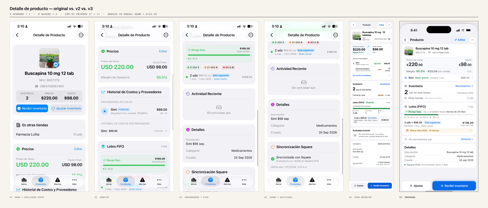
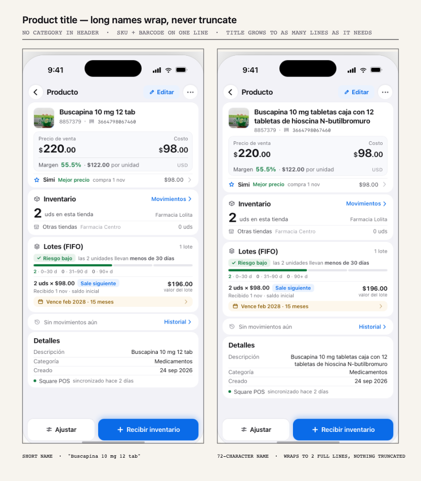

# Detalle de producto — findings to improve the screen as built

**Scope:** the product detail screen currently shipped in the app (v1, four scrolls) and the
redesign in progress (v2, one screen). Reviewed against the handler's two real jobs: *is this
product making me money* and *is it about to cost me money*.

**What this is:** a prioritised list of changes, not a redesign brief. Each finding states the
evidence, why it costs the user something, and the smallest change that fixes it. Items marked
**shipped in v3** are already in the proposed screen.

| | |
|---|---|
| Screens to reach cost + supplier | 4 → 1 |
| Top-level blocks | 8 → 5 |
| Times `$98.00` is printed | 3 → 1 |
| Margin expressed in money | none → `$122.00` |
| Contrast of green money text | 2.22:1 → 5.35:1 |

---

## P2 — do first (three items, in this order)

### 1. Show margin in pesos, not only percent

**Evidence:** the Precios block shows `55.5%` and nothing else.

A percentage says the product is healthy. It does not say what one unit puts in the till, and it
is not a number you can multiply by quantity. The margin the handler can act on is
`$220.00 − $98.00 = $122.00` per unit, or `$244.00` across the two units on the shelf.

**Fix:** `Margen 55.5% · $122.00 por unidad`. Keep the percentage — it is the comparable figure —
but stop making it the only one.

*Shipped in v3.*

---

### 2. Remove the unresolved placeholder row

**Evidence:** the supplier block renders literal brackets:
`[Otro proveedor]`, `[Última compra 1 nov]`, `[+{dif}]`, `[$ costo]`, `[N]`.

This is not polish, it is a broken row — and it appears for every product with only one supplier
on record, which is the common case. It also renders `Ver los [N] proveedores` with `N = 1`.

**Fix:** replace the second-supplier row with a single empty-state row,
`Sin proveedor alterno · agregar`. Hide the "ver proveedores" link entirely when `N = 1` — the one
supplier is already on screen.

*Shipped in v3.*

---

### 3. Add expiry date and a low-stock threshold

**Evidence:** a medicine with 2 units and 1 lot has no expiry field anywhere in the record, and
the page reports `Riesgo bajo` in green.

`Riesgo bajo` describes FIFO aging, but at 20pt in green it reads as an all-clear for the whole
product. Today an expired lot, a stock-out and a count of one all render identically to a healthy
state. For a pharmacy, expiry is the field that matters most and it is not captured at all.

**Fix:** add `caducidad` to the lot, a low-stock threshold tied to sell-through, and a three-state
chip that escalates green → amber → red. "Riesgo bajo" should be the neutral case, never the default.

*Shipped in v3 (caducidad row + chip); threshold still needs a product-level setting.*

---

## P1 — next

### 4. One cost per unit, with its provenance

**Evidence:** `$98.00` appears three times — `Costo actual`, the supplier row, and
`2 uds × $98.00` in the lot.

Three appearances of one number, with no label saying whether it is the average paid, the current
supplier price, or the cost of the lot that will sell next. They are identical today; a bad
purchase would make them diverge, and the screen would then be genuinely ambiguous about which
cost the margin used.

**Fix:** one cost per unit in the economics block, with provenance on the same line
("Simi · compra 1 nov"). Lot rows carry lot-scoped totals only.

---

### 5. Rename "inmovilizado", demote it

**Evidence:** `$196.00 inmovilizado` is set at ~20pt on a green field — the loudest element in
the lot block.

Money is not stuck, it is inventory doing its job, valued at cost. The label frames normal stock
as frozen capital. Meanwhile the number a reorder decision needs — how fast it sells — is absent,
so "inmovilizado" is asked to carry an argument it cannot support.

**Fix:** rename to `valor del lote` and move it to the row's trailing position. Translate the aging
into a sentence — "las 2 unidades llevan menos de 30 días en piso" — instead of a bar whose
denominator is 2 units.

*Shipped in v3.*

---

### 6. Split green's four jobs, and fix the contrast

**Evidence:** the green that marks `Riesgo bajo` also marks margin, the sale price and the Square
check. The money green is iOS systemGreen, which measures **2.22:1** on white — below the 4.5:1
floor for text — and it is set at 34pt bold, compensating with size rather than legibility.

When everything is green, green stops meaning "fine".

**Fix:** money is ink (near-black, tabular); green is reserved for state. Use an accessible green
(`#0F7B3F`, 5.35:1) for anything textual. And `Agotado 0 uds` in red for a branch that simply
does not carry it is a false alarm — that is a neutral `0 uds`.

*Shipped in v3.*

---

## P2 — batch these

### 7. Collapse the empty activity state

**Evidence:** `Actividad reciente` occupies ~140pt with a divider, an illustration and two lines of
type — to say nothing happened. It sits above `Categoría / Descripción / Creado`, pushing cheap,
always-present facts off the first screen.

**Fix:** collapse to a 44pt row, `Sin movimientos aún · Historial →`. Reserve the tall card for
when there are events. Move the identity facts into the header where they cost no height.

*Shipped in v3.*

---

### 8. One date format, one currency format

**Evidence:** `1 nov 2026` · `24 sep 2026` · `2 nov 2026, 2:57 a.m.` · `USD 220.00` · `$220.00` · `$ 98.00`

Small and cumulative. Inconsistent formatting reads as unreliable data even when the data is
right — and on a screen whose job is "can I trust this number", that is a real cost. v1 is worse:
it mixes `USD`, `$`, and a dot separator inside one card.

**Fix:** one formatter per type. Dates `24 sep 2026`; timestamps `2 nov · 2:57 a.m.`; money
`$220.00` with the currency stated once per block.

Also: the same product is called `Buscapina 10 mg 12 tab` in one place and `Simi $98 sep` in
another. Pick one canonical name; the supplier descriptor belongs with supplier data.

---

## Header specifics (requested changes, shipped in v3)

### 9. Remove the category from the header

The header read `SKU 8857379 · Medicamentos`. `Categoría` already exists in Detalles, so the
header was repeating a field that is one card below. Removing it gives the title the full width
and removes a third competing string from the identity block.

### 10. Show SKU and barcode on one line

The barcode (`3664798067460`) was a long opaque string under the SKU, then briefly moved into
Detalles. It now sits on the metadata line as `8857379 · ‖ 3664798067460` — scannable, monospaced,
never decorative.

### 11. Never truncate the product name

The name was constrained to a single line. Real pharmacy names run long — strength, form, count,
active ingredient — and the name is the one thing that identifies the record.

**Fix:** the title wraps to as many lines as it needs (`overflow-wrap: break-word`, no
`text-overflow`, no `line-clamp`). The card grows; nothing is clipped. `Descripción` in Detalles
uses the same full string, so the two can never disagree.

**Verified:** a 72-character name
(`Buscapina 10 mg tabletas caja con 12 tabletas de hioscina N-butilbromuro`) renders 2 full lines
at 295px wide, `scrollHeight` 38px vs `clientHeight` 38px — no clipping — and the record still
fits without scrolling.

---

## Smaller items

| Area | Finding |
|---|---|
| **Photo** | Thumbnail is a hand holding a box on a shelf, shot in-store, with the camera badge overlapping the artwork. Prefer the package front and keep the badge outside the image bounds. |
| **Two "Editar"s** | One in the nav, one in Precios. If they edit different things, label the second for what it edits. If they are the same, drop one. |
| **Nav ···** | With only archive/delete available, the ellipsis is a mystery. Populate it or remove it — an empty menu is a dead end users tap twice. |
| **Missing verb** | Nothing answers "how fast does this move?". Sell-through or last-sold would tie stock, margin and reorder into one story. |
| **Accessibility** | Risk is encoded as colour alone (chip colour, bar colour) with no glyph or text change. Add one. Keep the two action buttons at 44pt — they read closer to 40 in v2. |

---

## Still open (needs a product decision, not a code change)

1. **Low-stock rule.** What threshold? Per-product, per-category, or days-of-cover?
2. **Expiry escalation.** At how many days does a lot turn amber, and then red?
3. **Sell-through.** Which source: Square sales history, or manual counts?
4. **Multi-supplier.** Is a supplier list a full screen, or a sheet?

---

## Notes on the v3 proposal

- v3 is a **proposal, not a spec.** Spacing values are set for a 402×874 viewport and will need
  re-checking on an iPhone SE (375pt) and in Dynamic Type.
- All figures are from the provided screenshots. No data was invented; `$122.00` is `220 − 98`, and
  `$244.00` is that × 2 units.
- Copy is in Spanish to match the app. Nothing in v3 is localised yet.

### Files

| File | What it is |
|---|---|
| `mockups/product-detail/comparison-original-vs-v3.png` | Original 4 screens → v2 → v3, side by side |
| `mockups/product-detail/title-long-name.png` | Short vs. 72-character name |
| `mockups/product-detail/v3-product-detail.png` | v3, 402×874 |
| `mockups/product-detail/v3-product-detail-long-name.png` | v3 with a long name, 402×874 |
